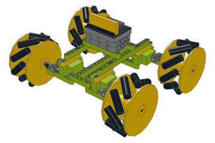
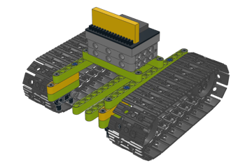
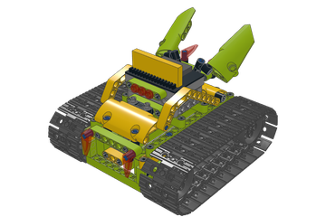
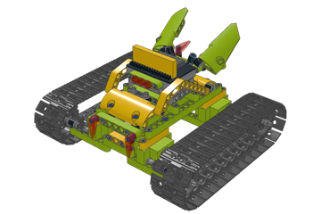
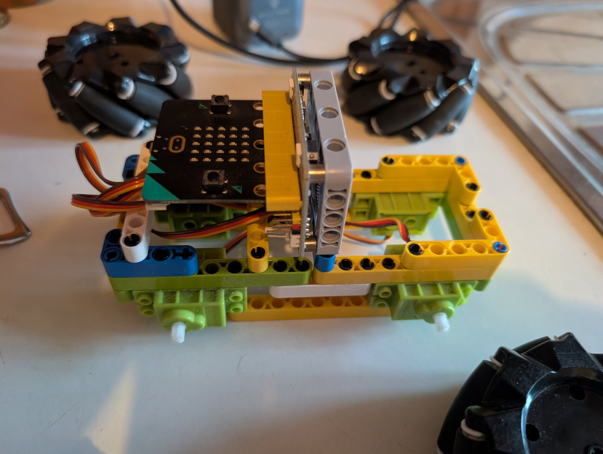

# GeekEdu Brick Race: Wukong cars

Four brick cars of the [GeekEdu Brick Race](https://legorace.geekedu.eu/en/), each on an
ElecFreaks Wukong board with a BBC micro:bit, written as LDraw models in Python. They share a plain
body of beams and frames (since 2026-10-31; the kit's hood, wings and horns are gone) and, but for
the two plain tanks, a gear drive: the wheels and sprockets sit on their own axles. The builder turns
them into building booklets and BrickLink Studio files. Each car also has its micro:bit firmware
for the phone joystick.

| | Model | Motors on the Wukong board | Steps | Parts |
|---|---|---|---|---|
|  | **wukong-mecanum**: the mecanum racer; drives, turns on the spot and slides sideways. A plain body of beams and frames; each wheel on its own axle, turned 1:1 by two 12-tooth gears from the servo (set the driver's DIRECTION to -1); the axle's bearing is a pin with pin hole hanging from an L-beam on a frame of 7-beams and 3-beams two studs outboard of the gears | 4 Geekservo 360° servos: S0 left front, S1 left rear, S2 right front, S3 right rear | [17, online](https://legorace.geekedu.eu/en/models/wukong-mecanum-racer/) · [PDF](https://github.com/cznewt/gedu-brick-race/releases/latest/download/wukong-mecanum-instructions.pdf) | 129 |
|  | **wukong-tank-2-motors**: the racer's body on tracks, driven at the back, the sprockets on the servos | 2 Geekservo 360° servos: S0 left, S1 right | [14, online](https://legorace.geekedu.eu/en/models/wukong-tank-2servo/) · [PDF](https://github.com/cznewt/gedu-brick-race/releases/latest/download/wukong-tank-2-motors-instructions.pdf) | 117 |
|  | **wukong-tank-4-motors**: the racer's body on tracks, all four motors driving, the sprockets on the servos | 4 Geekservo 360° servos: S0 left front, S1 left rear, S2 right front, S3 right rear | [12, online](https://legorace.geekedu.eu/en/models/wukong-tank-4servo/) · [PDF](https://github.com/cznewt/gedu-brick-race/releases/latest/download/wukong-tank-4-motors-instructions.pdf) | 119 |
|  | **wukong-tank-4-motors-geared**: the four-motor tank geared up 2:1: a 16-tooth gear on each servo turns an 8-tooth one on an axle in the racer's bearing frames; the sprocket sits on that axle; a low idler in the middle of each belt shapes it like the Building:bit tank's, so the tank stands on the idlers. About the mecanum car's speed, half the pull. A prototype: the gears mesh 0.65 mm wider than LEGO's standard spacing, and the car is 21.2 cm wide over the tracks (the Building:bit links are 5 studs wide, so they start outboard of the gears and of the bearing frames). The drive is steps 10-18 | 4 Geekservo 360° servos: S0 left front, S1 left rear, S2 right front, S3 right rear | [20, online](https://legorace.geekedu.eu/en/models/wukong-tank-4servo-geared/) · [PDF](https://github.com/cznewt/gedu-brick-race/releases/latest/download/wukong-tank-4-motors-geared-instructions.pdf) | 216 |

## Users' models

Cars built by people at the races live in `models/users/<slug>/`: photos, a short README with the
builder's name and what drives it, and, once the beams and pins are measured, the model script and
booklet like the four above. Send photos from the front, a side, the top and the bottom, the kit the
parts come from, and which driver you flash, and we draw it.

| | Model | Builder | Drive |
|---|---|---|---|
|  | [**compact-mecanum-car**](models/users/compact-mecanum-car/): four small Geekservo 360s in a tight frame, black 60 mm mecanum wheels straight on them, the board upright | Aleš Komárek | the mecanum driver, DIRECTION 1 |

## Download

Each [release](https://github.com/cznewt/gedu-brick-race/releases) has these files for every model:

- `<model>-studio.zip`: the model with its building steps for
  [BrickLink Studio](https://www.bricklink.com/v3/studio/download.page), the custom parts it needs
  (the electronics) and how to install them (`README.txt`, `README-cs.txt`).
- `<model>-instructions.pdf`: the printable A4 building booklet.
- `<model>-bricklink.xml`: a BrickLink wanted list of its LEGO parts.
- `<model>-parts.csv`: every part with its colour and quantity, and a shop link for the electronics.
- `<model>-firmware.hex`: the car's micro:bit program, one file for V1 and V2. Copy it onto the
  `MICROBIT` drive.
- `<model>.zip`: the files above except the firmware, plus the cover and every step picture.

Every car's building steps are also online, one picture per step, on [the challenge's site](https://legorace.geekedu.eu/en/models/)
(its *Steps* link in the table above), where you can turn it in 3D as well. The *PDF* link is the latest release's booklet.

## Drive it

1. Flash the car's program onto its micro:bit. Either copy `<model>-firmware.hex` from a release
   onto the `MICROBIT` drive, or download it from the
   [GeekEdu MakeCode editor](https://makecode-microbit.geekedu.eu/) (its *Brick Race*
   row), where you can also change it.
2. Drive it from a phone with the [phone joystick](https://makecode-microbit.geekedu.eu/joystick/):
   Chrome on Android, Bluefy on iPhone.

A game controller drives too: an Android handheld's own sticks (such as the Retroid Pocket Flip 2)
or a Bluetooth or USB gamepad, in Chrome. The left stick drives, the right stick slides the
mecanum car. Connect is still a tap on the screen.

The sources are in [`firmware/`](firmware/README.md), one MakeCode project per car, with its ports,
settings and motor test.

| Model | Program | Wiring |
|---|---|---|
| wukong-mecanum | [Elecfreak Wukong Mecanum Car (Bluetooth)](https://makecode-microbit.geekedu.eu/#example:/projects/elecfreak-wukong-mecanum-car-bluetooth) with DIRECTION at -1 (the 1:1 gears turn each wheel the other way round) | [drawing](https://makecode-microbit.geekedu.eu/joystick/motors.html#mecanum) |
| wukong-tank-2-motors | [Wukong Tank, 2 Servos (Bluetooth)](https://makecode-microbit.geekedu.eu/#example:/projects/geekedu-wukong-tank-2servo-bluetooth) | [drawing](https://makecode-microbit.geekedu.eu/joystick/motors.html#tank-2servo) |
| wukong-tank-4-motors | [Wukong Tank, 4 Servos (Bluetooth)](https://makecode-microbit.geekedu.eu/#example:/projects/geekedu-wukong-tank-4servo-bluetooth) | [drawing](https://makecode-microbit.geekedu.eu/joystick/motors.html#tank-4servo) |
| wukong-tank-4-motors-geared | the four-motor tank's, every servo at -1 (the gears turn each track the other way): [`firmware/wukong-tank-4-motors-geared`](firmware/wukong-tank-4-motors-geared/README.md) | [drawing](https://makecode-microbit.geekedu.eu/joystick/motors.html#tank-4servo) |

## Build the files yourself

You need Python 3.10+, the DejaVu fonts and network access while building: three.js comes from
jsDelivr, and the LDraw parts from GitHub (cached in `~/.cache/geekedu-ldraw`).

```sh
just setup                  # pip install -r requirements.txt + Playwright's Chromium
just build wukong_mecanum   # or: python3 builder/build.py wukong_mecanum
just all                    # every model
```

Each model lands in `dist/<model>/` and `dist/<model>.zip`. The firmware takes Node.js, or Docker
for `just firmware`:

```sh
just firmware               # dist/<model>/<model>-firmware.hex
just sync-firmware          # pull the drivers' current release from the GeekEdu editor
```

[docs/TECHNICAL_DOC.md](docs/TECHNICAL_DOC.md) explains how the builder and the firmware build work,
and how to add a model.

## Repository

| Path | What |
|---|---|
| `models/` | one Python script and one JSON file per model; `tracks.py` and `wonder_common.py` hold shared parts of the designs |
| `builder/` | LDraw handling, three.js renders, instruction pages, the booklet, the Studio zip and the parts lists |
| `firmware/` | the cars' micro:bit programs: one MakeCode project per car, `sync.py` (from the GeekEdu editor) and `build.sh` (hex files) |
| `docs/` | [user guide](docs/USER_DOC.md), [technical documentation](docs/TECHNICAL_DOC.md), [user stories](docs/USER_STORIES.md) |
| `.github/workflows/build.yml` | builds every model on each push; a `v*` tag publishes a release |

## Licences and credits

- **Builder and firmware:** MIT, see [LICENSE](LICENSE).
- **Models and everything built from them:** CC BY-SA 4.0. The custom part files are CC BY 4.0. See
  [models/LICENSE.md](models/LICENSE.md).
- **Designs:**
  - `wukong-mecanum` reproduces the mecanum car of the ElecFreaks Wonder Rugged Kit from its booklet;
    the design is ElecFreaks'.
  - The tanks are GeekEdu designs on that car's body, with tracks from the Yahboom Building:bit
    kit.
- **LDraw parts:** they come from the [LDraw parts library](https://www.ldraw.org/) while building and
  are not part of this repository. LDraw is a trademark of the Estate of James Jessiman.
- **Trademarks:** LEGO® is a trademark of the LEGO Group, which does not sponsor, authorise or endorse
  this project. ElecFreaks, Wukong, Geekservo, Yahboom, Building:bit, micro:bit and BrickLink are
  trademarks of their owners.
